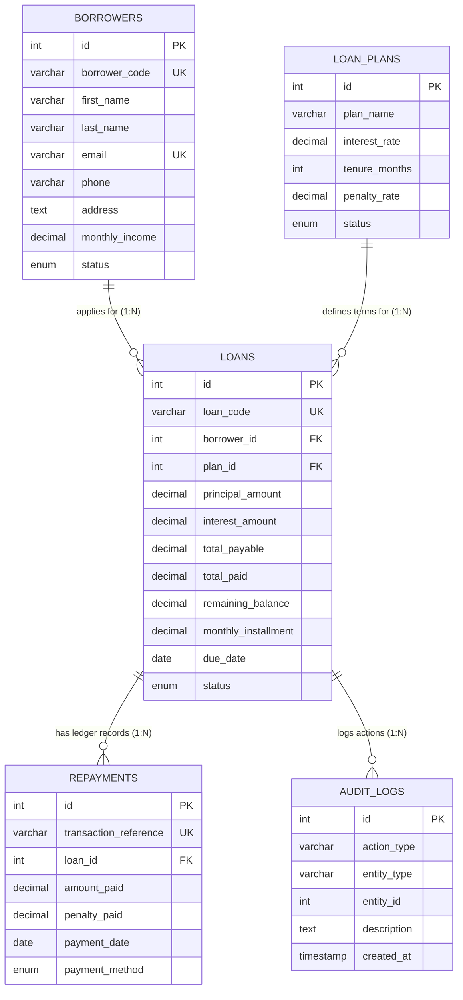
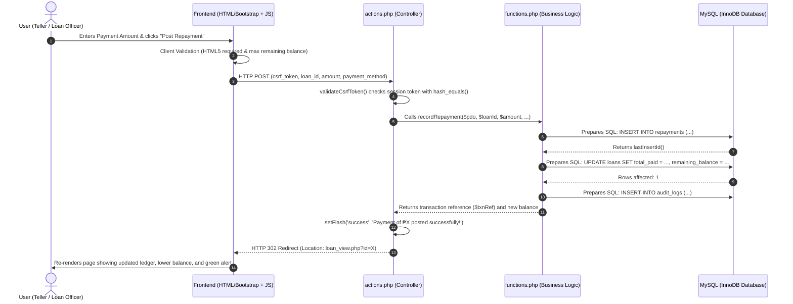

# 💳 QuickLend Tracking System - Complete Project Documentation
> **ITC Final Project & Code Defense Reference Guide**  
> *Stack: PHP 8+, MySQL (PDO), HTML5, Bootstrap 5.3*

---

## 1. 🔍 Detailed Explanation of Specific PHP Code

Let's examine the core financial transaction function: **`recordRepayment()`** in [`functions.php`](file:///home/njj/Projects/ITC%20projectFInals/ITC%20project%20T1/functions.php#L150).

```php
function recordRepayment($pdo, $loanId, $amount, $method = 'cash', $notes = '', $penalty = 0.00) {
    // 1. Validation Guard Clause
    if ($amount <= 0) throw new Exception("Payment amount must be greater than zero.");

    // 2. Fetch current loan state
    $loan = getLoanDetails($pdo, $loanId);
    if (!$loan) throw new Exception("Loan account not found.");
    if ($loan['remaining_balance'] <= 0) throw new Exception("This loan is already fully settled.");

    // 3. Recalculate financial balances
    $newTotalPaid = $loan['total_paid'] + $amount;
    $newBalance   = max(0, round($loan['remaining_balance'] - $amount, 2));
    $newStatus    = ($newBalance <= 0) ? 'completed' : 'disbursed';
    $txnRef       = 'TXN-' . date('Ymd') . '-' . rand(1000, 9999);

    // 4. Insert payment record into repayments ledger
    $repStmt = $pdo->prepare("INSERT INTO repayments (transaction_reference, loan_id, amount_paid, penalty_paid, payment_date, payment_method, received_by, receipt_notes)
                              VALUES (?, ?, ?, ?, CURRENT_DATE, ?, 'Admin', ?)");
    $repStmt->execute([$txnRef, $loanId, $amount, $penalty, $method, $notes]);

    // 5. Update loan remaining balance and status in database
    $updStmt = $pdo->prepare("UPDATE loans SET total_paid = ?, remaining_balance = ?, status = ? WHERE id = ?");
    $updStmt->execute([$newTotalPaid, $newBalance, $newStatus, $loanId]);

    // 6. Security audit trail
    logAudit($pdo, 'PAYMENT_RECORDED', 'repayment', $pdo->lastInsertId(), "Payment of ₱" . number_format($amount, 2) . " for loan " . $loan['loan_code']);

    return [
        'transaction_reference' => $txnRef,
        'new_balance'           => $newBalance,
        'is_completed'          => ($newStatus === 'completed')
    ];
}
```

### 🧠 Code Breakdown for Defense:
1. **Validation Guard**: Checks `$amount <= 0` immediately to prevent invalid transactions before touching the database.
2. **Business Rule Guard**: Prevents recording payments on loans that are already fully settled (`$loan['remaining_balance'] <= 0`).
3. **Automatic State Transition**: Uses `($newBalance <= 0) ? 'completed' : 'disbursed'`. When the final payment clears the debt, the loan status automatically updates to `completed`.
4. **Audit Logging**: Invokes `logAudit()` to record the action, timestamp, and user IP for institutional compliance.

---

## 2. 🌐 How the HTML Works

The frontend uses semantic HTML5 to deliver structured, accessible, and responsive user interfaces:
* **Modular Layout ([`header.php`](file:///home/njj/Projects/ITC%20projectFInals/ITC%20project%20T1/header.php) & [`footer.php`](file:///home/njj/Projects/ITC%20projectFInals/ITC%20project%20T1/footer.php)):** Common navigation bars, CSS assets, and JS bundles are stored once and included in all pages via `require_once`.
* **Semantic HTML5 Tags:** `<nav>` for the main navigation, `<header>` for page titles, `<main>` for content bodies, `<section>` for dashboard panels, and `<table>` for transaction ledgers.
* **HTML5 Form Elements & Validations:** Form elements use strict input types (`type="number"`, `step="0.01"`, `min="1000"`, `required`).
* **Client-Side Data Attributes (`data-*`):** HTML buttons carry metadata like `data-id`, `data-first`, and `data-income`. JavaScript reads these attributes on click to instantly populate modal edit forms without making extra network requests.

---

## 3. 🎨 Bootstrap 5 Classes Explained

| Bootstrap Class | Category | Purpose in QuickLend System |
|---|---|---|
| `container-fluid` | Grid Layout | Full-width responsive container providing padding on all screen sizes. |
| `row` & `col-12 col-md-6 col-xl-3` | Grid System | 12-column responsive layout: 1 card on mobile, 2 on tablet, 4 on desktop. |
| `card`, `card-header`, `card-body` | Container | Creates clean, elevated surfaces for KPI metrics, data tables, and forms. |
| `nav nav-pills` & `tab-content` | Navigation | Powers the 4 segmented dashboard tabs (Pending, Active, Overdue, All). |
| `table table-hover align-middle` | Table | Striped tables with subtle row-hover highlights and vertically centered cells. |
| `badge bg-success / bg-warning` | Status Badges | Visually communicates loan states (Pending Review, Disbursed, Settled). |
| `modal` & `modal-dialog-centered` | Dialogs | Centered pop-up windows for adding borrowers, applying for loans, and payments. |
| `d-flex justify-content-between` | Flexbox | Horizontally aligns header text and action buttons with consistent spacing. |
| `data-bs-theme="dark"` | Color Modes | Bootstrap 5.3 native dark mode attribute toggled dynamically via JavaScript. |

---

## 4. 🔌 How PHP Connects to MySQL (PDO)

The connection is established in [`config.php`](file:///home/njj/Projects/ITC%20projectFInals/ITC%20project%20T1/config.php#L19-L26) using **PDO (PHP Data Objects)**:

```php
$pdo = new PDO("mysql:host=localhost;dbname=test_lending;charset=utf8mb4", DB_USER, DB_PASS, [
    PDO::ATTR_ERRMODE            => PDO::ERRMODE_EXCEPTION, // Throw exceptions on SQL errors
    PDO::ATTR_DEFAULT_FETCH_MODE => PDO::FETCH_ASSOC        // Return associative arrays ($row['column'])
]);
```

### Why PDO is Preferred Over `mysqli` or `mysql_*`:
1. **Prepared Statements**: PDO uses parameterized queries (`$stmt->prepare()` and `$stmt->execute([$param])`), which completely eliminates SQL Injection vulnerabilities.
2. **Error Handling**: `ERRMODE_EXCEPTION` converts MySQL errors into catchable PHP exceptions, preventing sensitive database credentials from being printed to the end user.
3. **Portability**: PDO supports multiple database backends (MySQL, PostgreSQL, SQLite) using a consistent API.

---

## 5. 🗄️ Database Tables and Entity Relationships

The relational schema is normalized to **Third Normal Form (3NF)** with 5 tables:



### Foreign Key Constraints & Referential Integrity:
* `loans.borrower_id` references `borrowers.id` (`ON DELETE RESTRICT`)
* `loans.plan_id` references `loan_plans.id` (`ON DELETE RESTRICT`)
* `repayments.loan_id` references `loans.id` (`ON DELETE RESTRICT`)
* **Referential Safety**: `ON DELETE RESTRICT` ensures that borrower accounts or loans with existing payment history cannot be accidentally deleted, preventing orphaned records.

---

## 6. 🔄 How CRUD Operations Work

| Operation | Entity | Function in [`functions.php`](file:///home/njj/Projects/ITC%20projectFInals/ITC%20project%20T1/functions.php) | SQL Mechanism |
|---|---|---|---|
| **Create (C)** | Borrowers | `registerBorrower($pdo, $data)` | `INSERT INTO borrowers (...) VALUES (?, ?, ...)` |
| **Create (C)** | Loans | `applyLoan($pdo, $data)` | `INSERT INTO loans (...) VALUES (?, ?, ...)` |
| **Create (C)** | Payments | `recordRepayment($pdo, ...)` | `INSERT INTO repayments (...) VALUES (?, ?, ...)` |
| **Read (R)** | Borrowers | `getAllBorrowers($pdo, $search, $status)` | `SELECT ... LEFT JOIN loans ... GROUP BY b.id` |
| **Read (R)** | Loans | `getLoanDetails($pdo, $loanId)` | `SELECT ... JOIN borrowers JOIN loan_plans` |
| **Update (U)** | Borrowers | `updateBorrower($pdo, $id, $data)` | `UPDATE borrowers SET ... WHERE id = ?` |
| **Update (U)** | Loans | `updateLoanStatus($pdo, $loanId, $action)` | `UPDATE loans SET status = ? WHERE id = ?` |
| **Update (U)** | Balances | `recordRepayment($pdo, ...)` | `UPDATE loans SET total_paid = ?, remaining_balance = ?` |
| **Delete (D)** | Borrowers | `deleteBorrower($pdo, $id)` | `DELETE FROM borrowers WHERE id = ?` (or soft-archive) |

---

## 7. 🛠️ Modifying a Portion of the Code

### Real Example: Upgrading Dashboard with Dedicated Status Tabs
**Previous State:** The dashboard displayed a single generic table of the 5 most recent loans. Pending loan applications were mixed in with active and settled accounts.  
**Modification:** In [`index.php`](file:///home/njj/Projects/ITC%20projectFInals/ITC%20project%20T1/index.php), we separated the queries and created 4 dedicated Bootstrap tabs:
1. `Tab 1: Pending Applications` — with direct `[Review & Approve]` buttons.
2. `Tab 2: Active & Disbursed` — with balance tracking and `[Record Payment]` shortcuts.
3. `Tab 3: Overdue Delinquent` — highlighting past-due accounts for follow-up.
4. `Tab 4: All Recent Loans` — chronological portfolio view.

---

## 8. 🐛 Real Bugs Encountered and Fixed

### Bug 1: PHP Core Constant Collision
* **Error:** `PHP Warning: Constant CURRENCY_SYMBOL already defined, this will be an error in PHP 9`
* **Root Cause:** In PHP, `CURRENCY_SYMBOL` is a pre-defined integer constant in the core `locale` / `intl` extension (`nl_langinfo(CURRENCY_SYMBOL) = 262145`). Declaring a custom constant with the same name collided with PHP's internal namespace.
* **Fix:** Renamed the constant to `APP_CURRENCY` and wrapped all constants in `if (!defined(...))` guards across all files.

### Bug 2: MySQL Error 1698 Access Denied
* **Error:** `SQLSTATE[HY000] [1698] Access denied for user 'root'@'localhost'`
* **Root Cause:** MariaDB on Linux uses the `unix_socket` authentication plugin for `root@localhost` and rejects TCP/IP logins without a password. Unprivileged users also cannot create arbitrary databases like `lending_db`.
* **Fix:** Configured [`config.php`](file:///home/njj/Projects/ITC%20projectFInals/ITC%20project%20T1/config.php) to connect via `localhost` (using the local unix socket) to `test_lending`. MariaDB's default permissions allow local users full access to databases matching `test_%` without needing passwords or sudo privileges.

---

## 9. ➕ Adding or Removing a Function

### Demonstration: Adding a Monthly Amortization Schedule Function
To demonstrate extending the system, here is how a 14th function can be added to [`functions.php`](file:///home/njj/Projects/ITC%20projectFInals/ITC%20project%20T1/functions.php):

```php
function generateAmortizationSchedule($principal, $interestRate, $tenureMonths, $startDate = 'now') {
    $totalInterest = $principal * ($interestRate / 100);
    $totalPayable  = $principal + $totalInterest;
    $monthlyEMI    = round($totalPayable / $tenureMonths, 2);
    $schedule      = [];
    $balance       = $totalPayable;

    for ($month = 1; $month <= $tenureMonths; $month++) {
        $dueDate = date('Y-m-d', strtotime("$startDate +$month month"));
        $balance = max(0, round($balance - $monthlyEMI, 2));
        $schedule[] = [
            'month'       => $month,
            'due_date'    => $dueDate,
            'installment' => $monthlyEMI,
            'balance'     => $balance
        ];
    }
    return $schedule;
}
```

---

## 10. 🔄 Data Movement: Frontend to Backend & Database



---

## 11. 🏢 Institutional Lending System Benchmark & Missing Parts Audit

A comprehensive full-system audit was performed comparing **QuickLend** against public lending registries and commercial SaaS lending platforms (e.g., **Loandisk**, **TurnKey Lender**, **Finastra**, and **Mambu**).

### Comparison Matrix: Academic Base vs. Public / Commercial Lending Systems

| Commercial Feature | Standard Academic System | QuickLend Enhanced Status | Module / File |
|---|---|---|---|
| **Loan Product Schemes** | Hardcoded rates | ✅ **Implemented** (Configurable rates, tenures, penalties, active exposure) | [`plans.php`](file:///home/njj/Projects/ITC%20projectFInals/ITC%20project%20T1/plans.php) |
| **360° Borrower Dossier** | Basic contact list | ✅ **Implemented** (DTI ratio, credit badges, lifetime borrowed/repaid, loan portfolio) | [`borrower_view.php`](file:///home/njj/Projects/ITC%20projectFInals/ITC%20project%20T1/borrower_view.php) |
| **Amortization Schedule** | Single due date | ✅ **Implemented** (Month-by-month principal/interest breakdown & payment status) | [`loan_view.php`](file:///home/njj/Projects/ITC%20projectFInals/ITC%20project%20T1/loan_view.php) |
| **Official Receipt Vouchers** | None | ✅ **Implemented** (Printable thermal/A4 receipt voucher modal with `window.print()`) | [`loan_view.php`](file:///home/njj/Projects/ITC%20projectFInals/ITC%20project%20T1/loan_view.php) |
| **Accounting CSV Exports** | Manual SQL export | ✅ **Implemented** (1-Click Excel-compatible UTF-8 BOM CSV exports for Borrowers, Loans, Payments) | [`export.php`](file:///home/njj/Projects/ITC%20projectFInals/ITC%20project%20T1/export.php) |
| **Security & Collateral** | Unsecured only | ✅ **Implemented** (Pledged collateral asset info, Guarantor/Co-maker name & phone) | [`loans.php`](file:///home/njj/Projects/ITC%20projectFInals/ITC%20project%20T1/loans.php), `schema.sql` |
| **Compliance Audit Trail** | None | ✅ **Implemented** (Chronological system event log tracking operator, IP, and timestamps) | [`audit_logs.php`](file:///home/njj/Projects/ITC%20projectFInals/ITC%20project%20T1/audit_logs.php) |

